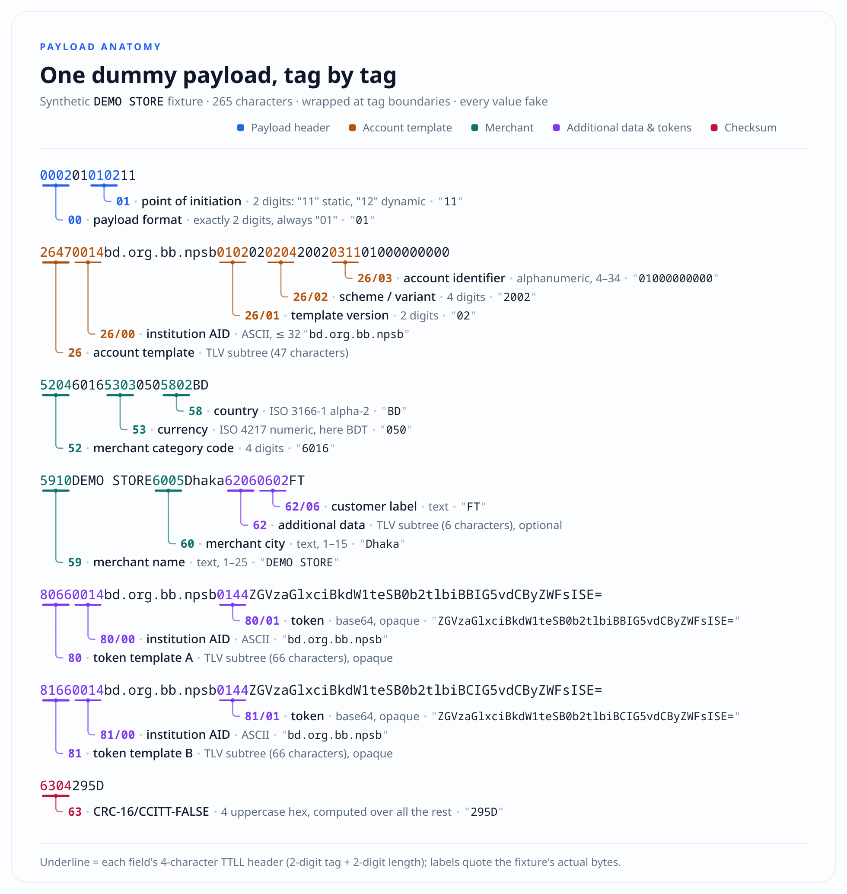

# deshiQR

**The engine: load a Bangla QR payload, edit any tag, and get the updated payload back.**

A Bangla QR (the NPSB/EMVCo-style format printed by bKash, bank apps and other Bangla QR apps) is a
TLV payload with a CRC. deshiQR parses it, applies your edits, keeps the point-of-initiation flag
consistent, re-seals the checksum (CRC-16/CCITT-FALSE), and returns the new payload. You render the QR
yourself, however you like.

deshiQR does not generate QR codes, read merchant semantics, or handle payments. It ships as
zero-dependency libraries for JavaScript/TypeScript and Python, and as a browser bundle on GitHub
Pages. There is no server and no database; it never holds funds, stores data, or confirms payments.

The public payment-page website built on top of this engine is a separate project:
**[DeshiPay](https://github.com/hello2himel/deshiPay)** — <https://deshipay.netlify.app>.

[](https://github.com/hello2himel/deshiQR/actions/workflows/ci.yml)
[](https://www.npmjs.com/package/deshiqr)
[](https://pypi.org/project/deshiqr/)
[](./LICENSE)

## Payload anatomy

A Bangla QR payload is a flat run of **TLV** fields — tag, length, value — glued together with no
separators and no terminator, and sealed by a checksum. The figure below shows the synthetic
`DEMO STORE` fixture from [docs/demo-payloads.md](./docs/demo-payloads.md) — one payload, 265
characters, every value fake — wrapped at tag boundaries. Each field's 4-character `TTLL` header is
underlined and annotated with the tag, its name, its properties, and the value it carries:



The final `63` field is a CRC-16/CCITT-FALSE over everything before it; `update` always re-seals it.
An amount edit flips `01` to `12`, inserts `54` after `53`, and re-seals `63` — everything else is
copied byte for byte. The full field table is in [docs/format.md](./docs/format.md#field-table).

## The API: two functions

```ts
import { update, validate } from "deshiqr";

// Payload in, edited payload out. Throw on invalid input.
const updated: string = update(payload, { amount: 500, reference: "BILL123" });

// Never throws: collects every error and warning.
const report = validate(updated);
// { ok: true, errors: [], warnings: [] }
```

The same two functions exist in Python (`pip install deshiqr`) and as a browser bundle
(`window.DeshiQR`) served from GitHub Pages.

`update(payload, edits, options?)`:

- `edits` keys are named aliases or tag paths; values are `string | number | null`.
- `null` removes the tag (or sub-tag). `63` is rejected — the checksum is always recomputed.
- `update(payload)` / `update(payload, {})` is **validate-only**: the payload comes back exactly as it
  went in (surrounding whitespace trimmed; warnings still surface).
- When the edits target the amount, tag `01` is kept consistent: `54` present → `01` is `12`, `54`
  absent → `01` is `11` (unless you edit `01` explicitly). Other edits leave `01` untouched.
- Only the tags you edit (plus `01` for amount edits and the re-sealed `63`) change. Everything else —
  account template, merchant name/city, currency, country, opaque token templates — is carried over
  byte for byte.
- Invalid input throws a `DeshiQrError` with a `.code`; duplicate tags are rejected (`DUPLICATE_TAG`).
  Warnings never block an edit: the new payload is still returned. See
  [docs/api.md](./docs/api.md#errors).

| Alias           | Tag path | Meaning                         |
| --------------- | -------- | ------------------------------- |
| `amount`        | `54`     | amount, exactly 2 decimals      |
| `currency`      | `53`     | ISO 4217 numeric (e.g. `050`)   |
| `country`       | `58`     | ISO 3166-1 alpha-2 (e.g. `BD`)  |
| `mcc`           | `52`     | merchant category code          |
| `name`          | `59`     | merchant name                   |
| `city`          | `60`     | merchant city                   |
| `reference`     | `62/01`  | bill number / payment reference |
| `customerLabel` | `62/06`  | customer label                  |
| `account`       | `26/03`  | account identifier              |
| `institution`   | `26/00`  | institution AID                 |

Any other key matching `^[0-9]{2}(/[0-9]{2})*$` is treated as a tag path (for example `"80/01"`).
Every field, its syntax and known values are in [docs/format.md](./docs/format.md#field-table); the full
editing rules are in [docs/api.md](./docs/api.md#update).

## Warnings and suppression

After applying edits, `update` validates the result and surfaces warnings. By default they go to
`console.warn`; `validate` returns them in the report. Warnings never block the edit.

```ts
update(payload, edits); // default: surface all warnings
update(payload, edits, { warnings: false }); // silence all warnings
update(payload, edits, { warnings: ["59", "62/01"] }); // suppress these tags/paths
update(payload, edits, { onWarning: (issue) => logger.warn(issue.code, issue.tag) });

validate(payload, { warnings: false }); // report without warnings; errors always present
```

Python takes the same options as a dict or a dataclass:

```python
from deshiqr import UpdateOptions, update

update(payload, edits, {"warnings": ["59"]})
update(payload, edits, UpdateOptions(warnings=False))
```

The `warnings` option matches an issue's `tag`/`path` exactly (`"59"`, `"62"`, `"62/01"`, `"26/03"`).
Warning codes include `MISSING_TAG`, `UNKNOWN_TAG`, `BAD_FIELD_VALUE`, `FIELD_TOO_LONG`,
`UNKNOWN_CURRENCY`, `NON_BD_COUNTRY`, `UNKNOWN_INSTITUTION`, `UNKNOWN_MCC`, `STATIC_WITH_AMOUNT`,
`DYNAMIC_WITHOUT_AMOUNT`, and `RISKY_EDIT`. The full table is in
[docs/api.md](./docs/api.md#warnings).

> **Editing identity fields is risky.** Changing `26/03` (account), `26/00` (institution) or `59`
> (merchant name) can mislead payers. `update` warns with `RISKY_EDIT`, but it does not stop you: only
> edit payloads you own. Read [SECURITY.md](./SECURITY.md).

## The API on GitHub Pages (no server)

The deshiQR library has no server, no database and no HTTP endpoint. The same two functions ship as a
static browser bundle, published to GitHub Pages by [`.github/workflows/pages.yml`](./.github/workflows/pages.yml):

```html
<script src="https://hello2himel.github.io/deshiQR/deshiqr.global.js"></script>
<script>
  const updated = DeshiQR.update(payload, { amount: 500, currency: "050" });
  const report = DeshiQR.validate(updated);
</script>
```

The edit runs in the visitor's browser. GitHub Pages is static-only — it cannot run server-side code
or accept POST requests — so the bundle is the whole "API". For server-side runtimes, use the npm
package (`deshiqr`) in Node/Deno/Bun or the Python package (`pip install deshiqr`); both are the same
implementation. An interactive demo of the bundle is published alongside it:
`https://hello2himel.github.io/deshiQR/`.

## Install

| Where                      | Install                       | How you call it                                           |
| -------------------------- | ----------------------------- | --------------------------------------------------------- |
| Node, bundlers, TypeScript | `npm install deshiqr`         | `import { update, validate } from "deshiqr"`              |
| Browser, no build step     | one `<script src>`            | `window.DeshiQR.update(…)` / `window.DeshiQR.validate(…)` |
| Python 3.9+                | `pip install deshiqr`         | `from deshiqr import update, validate`                    |
| Deno / Bun                 | `import … from "npm:deshiqr"` | the npm package resolves                                  |

Everything is zero-dependency and does no I/O. The library is synchronous and runs in browsers, Node,
Deno, workers and edge runtimes.

> These packages are released from this repo on a `v*` tag (see
> [CONTRIBUTING.md](./CONTRIBUTING.md#releases)). If a version is not on the registry yet, build from
> source (`pnpm build` and `pip install ./python`) or use the Pages bundle URL below.

### Plain JS, no build step

```html
<script src="https://cdn.jsdelivr.net/npm/deshiqr@0.1.0/dist/deshiqr.global.js"></script>
<script>
  const updated = DeshiQR.update(payload, { amount: 500 });
  document.querySelector("#payload").textContent = updated;
</script>
```

**GitHub-hosted URL (no npm publish needed).** The same bundle is published to GitHub Pages on every
`v*` tag (or manually from the Actions tab), see [`.github/workflows/pages.yml`](./.github/workflows/pages.yml):

```
https://hello2himel.github.io/deshiQR/deshiqr.global.js
```

`raw.githubusercontent.com` **cannot** be used in `<script src>`: it serves `text/plain` with
`X-Content-Type-Options: nosniff`, so browsers refuse to execute it. Use jsDelivr, unpkg or the Pages
URL above — or `raw.githack.com` if you need a URL pointing into the GitHub tree.

## Examples

One runnable example per platform. All of them use the synthetic `DEMO STORE` fixture from
[docs/demo-payloads.md](./docs/demo-payloads.md) — never a real merchant payload.

| Example                                            | Platform                              |
| -------------------------------------------------- | ------------------------------------- |
| [`examples/browser.html`](./examples/browser.html) | browser, single bundle, no build step |
| [`examples/node.mjs`](./examples/node.mjs)         | Node (ESM)                            |
| [`examples/python.py`](./examples/python.py)       | Python 3.9+                           |
| [`cdn/index.html`](./cdn/index.html)               | the GitHub Pages bundle demo          |

See [`examples/README.md`](./examples/README.md) for how to run each one.

## Repository layout

| Path                                     | What                                                                          |
| ---------------------------------------- | ----------------------------------------------------------------------------- |
| [`packages/deshiqr`](./packages/deshiqr) | npm `deshiqr` — `update` + `validate`, zero deps, ESM/CJS/types + IIFE bundle |
| [`python`](./python)                     | PyPI `deshiqr` — Python 3.9+ port of the same two functions                   |
| [`cdn`](./cdn)                           | demo page for the GitHub Pages browser bundle                                 |
| [`examples`](./examples)                 | one example per platform                                                      |
| [`docs`](./docs)                         | format, API reference, self-hosting, demo payloads                            |
| [`scripts`](./scripts)                   | repo tooling: browser-bundle check                                            |

## Documentation

- [Payload format](./docs/format.md) — every field, the checksum rule, a worked edit.
- [API reference](./docs/api.md) — `update`/`validate`, edit rules, warning and error codes.
- [Hosting on GitHub Pages](./docs/self-hosting.md) — publish the browser bundle and demo yourself.
- [Demo payloads](./docs/demo-payloads.md) — the synthetic fixtures used in tests and docs.
- [Python package](./python/README.md) — `pip install deshiqr`, same two functions.
- [Security policy](./SECURITY.md) — what deshiQR does and does not protect.
- [Contributing](./CONTRIBUTING.md) — setup, conventions, releases.

## Status

`0.1.0` — early and deliberately small. The payload editor is provider-agnostic by construction: it
only changes the tags you edit plus `01` and the checksum, so it works with any Bangla QR payload that
is well-formed TLV. There is no QR encoding, no payload reading, no merchant lookup, and no payment
confirmation here — this repo is only the engine.

The payment-page product built on top of this engine lives in the separate
**[DeshiPay](https://github.com/hello2himel/deshiPay)** repo (site: <https://deshipay.netlify.app>).

## License

[MIT](./LICENSE) © Himel Das. Not affiliated with bKash, Nagad, Rocket or NPSB.
